<!-- BEGIN animated project showcase -->
<picture>
  <source media="(prefers-reduced-motion: reduce) and (max-width: 600px)" srcset=".github/showcase/still-emerald-overview-mobile.svg">
  <source media="(prefers-reduced-motion: reduce)" srcset=".github/showcase/still-emerald-overview.svg">
  <source media="(max-width: 600px)" srcset=".github/showcase/emerald-overview-mobile.svg">
  
</picture>
<!-- END animated project showcase -->

# G Energy — EV charging demonstration

React + TypeScript + Vite frontend, ASP.NET Core 10 API, EF Core 10 and SQL Server. Includes authentication, vehicles and Driver assignments, sample station discovery, reservations, simulated charging, demo wallets/payments/refunds and protected Admin operations.

## Prerequisites

- .NET 10 SDK (global.json allows the latest installed 10.0 feature band).
- Node.js 22.12+ or a newer supported version; npm. Commit and use package-lock.json with `npm ci`.
- A reachable SQL Server instance or SQL Server Express LocalDB. The application does not substitute another database when SQL Server is unavailable.

## Backend setup (PowerShell, repository root)

```powershell
dotnet tool restore
dotnet restore
dotnet user-secrets set 'ConnectionStrings:DefaultConnection' 'Server=localhost;Database=GEnergyDb;Integrated Security=True;Encrypt=True;TrustServerCertificate=True' --project backend/GEnergy.Api
$taskJwtKey = [Convert]::ToBase64String([Security.Cryptography.RandomNumberGenerator]::GetBytes(48))
dotnet user-secrets set 'Jwt:SigningKey' $taskJwtKey --project backend/GEnergy.Api
Remove-Variable taskJwtKey
$env:ASPNETCORE_ENVIRONMENT = 'Development'
dotnet ef database update --project backend/GEnergy.Api
dotnet run --project backend/GEnergy.Api
```

The confirmed local development instance is SQL Server MSSQLSERVER at localhost, using Windows Authentication and the shared GEnergyDb database. See [Member 1 real SQL Server evidence](docs/sql-server-member1-verification.md). PowerShell 7 users can run `./scripts/Initialize-DevelopmentDatabase.ps1 -Through Latest` for repeatable non-destructive configuration and migration. The connection above is a local Windows-authentication example. Replace the server and authentication settings for your own instance, using user secrets or environment variables. TrustServerCertificate is for local development only. Migrations run explicitly; startup does not change the database automatically. Never use EnsureCreated for this application.

API: http://localhost:5080. Development Swagger UI: http://localhost:5080/swagger. Use **Authorize** with the login access token to call `/api/auth/me`.

Environment equivalents: `ConnectionStrings__DefaultConnection`, `Jwt__SigningKey`, `Jwt__Issuer`, `Jwt__Audience`, `Jwt__ExpirationMinutes`, `Cors__Origins__0`, `AllowedHosts`. Non-development hosting must provide HTTPS, a matching frontend HTTPS URL, appropriate hostnames and a secret store. appsettings.json deliberately contains no working connection string or signing key. The JWT key must contain at least 32 UTF-8 bytes; generate it randomly rather than inventing a passphrase.

## Development Admin bootstrap

Apply migrations first. In a PowerShell session, provide the bootstrap credentials without putting a password in command history:

```powershell
$env:ASPNETCORE_ENVIRONMENT = 'Development'
$env:AdminSeed__Email = Read-Host 'Admin email'
$env:AdminSeed__Password = [Net.NetworkCredential]::new('', (Read-Host 'Admin password (12–128 characters)' -AsSecureString)).Password
try {
    dotnet run --project backend/GEnergy.Api -- --seed-admin
} finally {
    Remove-Item Env:AdminSeed__Password -ErrorAction SilentlyContinue
    Remove-Item Env:AdminSeed__Email -ErrorAction SilentlyContinue
}
```

The command prints only the generated Admin UserCode. Log in using that code and the password you supplied. Repeating the seed with the same email returns the existing Admin code without changing its password. It refuses to promote an existing public account and refuses to run in Production. No default Admin password, production seeding or station seed is provided. The command is a development/demo bootstrap, not an Admin management API.

## Frontend setup (second terminal)

```powershell
cd frontend
Copy-Item .env.example .env
npm ci
npm run dev
```

Open http://localhost:5173. `VITE_API_BASE_URL` is a public build-time URL, never a secret. If the frontend origin changes, update the backend CORS allowlist. Production hosting must serve index.html for frontend routes such as `/dashboard/owner`; API requests continue to the separately configured API.

## Vehicle and discovery demo

After applying migrations, create Owner/Driver accounts using the existing signup flow. Owners can add vehicles, find a Driver by UserCode and manage CanCharge assignments. Drivers see only active assigned vehicles. The Vehicles and Stations links are available in authenticated navigation.

Seed the five clearly labelled sample locations in a Development shell:

```powershell
dotnet run --project backend/GEnergy.Api -- --seed-discovery
```

The command uses the configured SQL Server, is repeatable and does not run in Production. Discovery starts at a selectable demo origin; browser location is optional and requested only by a user click. The map has a list fallback. All distances are approximate straight-line values and all battery data is simulated.

Read [Member 2 API / shared integration contract](docs/member2-api.md) and [Member 2 test evidence / limitations](docs/member2-verification.md) before adding bookings or Admin changes. Member 3 now supplies BookingActivityGuard and BookingAvailabilityProvider. Read [booking/charging APIs and Member 4 settlement contract](docs/member3-booking-charging.md) and [Member 3 verification](docs/member3-verification.md). The Bookings & charging navigation connects reservations, the three-minute countdown, simulated charging and history. Member 4 now provides [demo wallets, top-ups, session settlement and refunds](docs/member4-wallet-payment.md). Owners access Wallet in navigation; Drivers continue charging while the Owner pays. All money movements are simulated. See [Member 4 verification](docs/member4-verification.md).

## Admin operations

Provision an Admin with the Development-only bootstrap above. The Admin dashboard reads real API counts; Admin tools manage station/charger configuration and provide read-only booking, session, transaction, wallet and coded user overviews. Changes require review and reject live reservations/charging or stale versions. Owners and Drivers cannot access Admin routes or APIs. See [Member 5 setup/API and QA guide](docs/member5-admin-qa.md), [actual release verification](docs/member5-verification.md) and [presentation login/walkthrough](docs/presentation-demo.md).

## Verify

```powershell
dotnet build
dotnet test
dotnet ef migrations has-pending-model-changes --project backend/GEnergy.Api
cd frontend
npm test
npm run build
npm audit
```

For SQL Server verification, set `G_ENERGY_TEST_SQLSERVER` to a connection string using a test-only SQL Server with permission to create databases, then run `dotnet test --filter FullyQualifiedName~SqlServerTests` from the repository root. Those isolated tests create random `GEnergy_AuthTests_<guid>` / `GEnergy_MobilityTests_<guid>` catalogs, apply migrations and delete only their own new catalogs in cleanup. It checks SQL sequence uniqueness, concurrent duplicate email handling, unique UserCode enforcement and SQL-backed login/me. It is explicitly skipped when the variable is unset. Never point test credentials at an environment where creating disposable databases is inappropriate.

Latest actual SQL Server evidence: [Member 1 identity](docs/sql-server-member1-verification.md) and [Member 2 shared database](docs/sql-server-member2-verification.md). All four migrations, including AddWalletAndPayments, are applied to GEnergyDb. To include all real-SQL tests, set both G_ENERGY_TEST_SQLSERVER and G_ENERGY_SHARED_SQLSERVER as documented; the latter retains labelled QA records in the shared development database.

See [API contract](docs/api-contract.md), [integration instructions](docs/integration.md) and [verification evidence / limitations](docs/verification.md). Initial identity SQL is available in [docs/initial-identity.sql](docs/initial-identity.sql); EF migrations remain authoritative.

## Repository map

- `backend/GEnergy.Api`: Controllers, DTOs, Entities, Data/Migrations, Services and Authorization.
- `frontend/src`: shared layouts/components, authentication context and guards, pages, typed API service and tests.
- `tests/GEnergy.IntegrationTests`: HTTP/security tests and opt-in SQL Server checks.
- `docs`: contracts, handoff and verification evidence.

No refresh token or recovery/OTP flow is in scope. Logout clears this tab's session; already-issued JWTs expire after 30 minutes by default. Account disablement or a role/UserCode change is enforced on each authenticated request. Browser sessions use sessionStorage to survive refresh in the same tab; bearer tokens must be protected from script injection. A production authentication design and operations review remains separate work.
